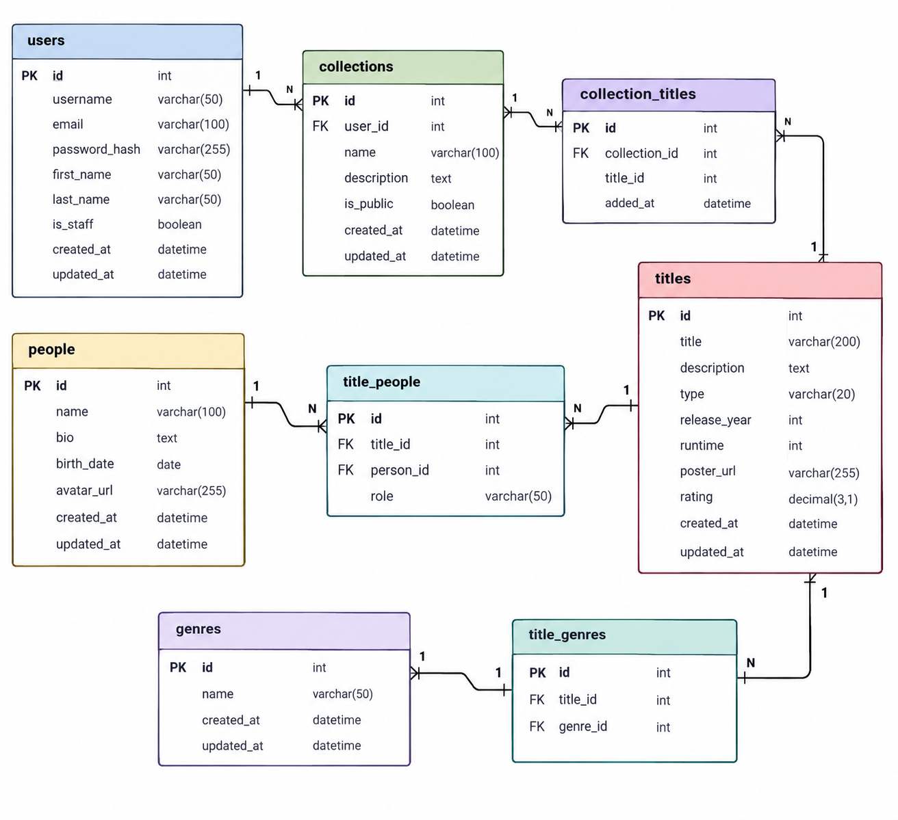

# 🎬 FilmShelf

## 📖 Опис проєкту

**FilmShelf** — це онлайн-бібліотека фільмів і серіалів, яка допомагає користувачам знаходити контент та впорядковувати його у власні колекції.

Користувачі можуть переглядати каталог, шукати фільми й серіали за назвою, фільтрувати результати за жанром, типом і роком виходу, а також переглядати детальну інформацію про кожну назву.

Зареєстровані користувачі можуть створювати власні колекції, додавати до них фільми й серіали та редагувати свій профіль.

Адміністратор може керувати каталогом, жанрами та інформацією про людей, які брали участь у створенні фільмів і серіалів.

## ✨ Основні можливості

- Перегляд каталогу фільмів і серіалів.
- Пошук за назвою.
- Фільтрація за типом, жанром і роком виходу.
- Сортування за назвою, роком виходу та рейтингом.
- Перегляд детальної інформації про фільми й серіали.
- Перегляд інформації про акторів, режисерів та інших учасників.
- Реєстрація, вхід і редагування профілю.
- Створення та редагування особистих колекцій.
- Додавання й видалення фільмів і серіалів у колекціях.
- Керування каталогом для адміністратора.

## 🔗 REST API

Базовий шлях API: `/api/v1`.

Усі запити та відповіді з даними використовують формат JSON, якщо для відповіді не зазначено відсутність тіла.

Для списків передбачені параметри:
- `page` — номер сторінки;
- `limit` — кількість записів на сторінці.

Приклад формату помилки:

```json
{
  "error": {
    "code": "not_found",
    "message": "Запис не знайдено"
  }
}
```

---

## 1. Каталог фільмів і серіалів

### `GET /api/v1/titles`

Отримати каталог із можливістю пошуку, фільтрації, сортування та пагінації.

**Query-параметри:**
- `search` — пошук за назвою;
- `type` — тип (`movie` або `series`);
- `genre_id` — ідентифікатор жанру;
- `year` — рік виходу;
- `sort` — сортування: `title`, `-title`, `release_year`, `-release_year`, `rating`, `-rating`;
- `page`, `limit` — пагінація.

**Відповідь:** `200 OK`.

Приклад відповіді:

```json
{
  "items": [
    {
      "id": 12,
      "title": "Interstellar",
      "type": "movie",
      "release_year": 2014,
      "rating": 8.7
    }
  ],
  "pagination": {
    "page": 1,
    "limit": 20,
    "total_items": 1,
    "total_pages": 1
  }
}
```

### `GET /api/v1/titles/{title_id}`

Отримати детальну інформацію про фільм або серіал.

**Параметри:** `title_id` у шляху.

**Відповіді:** `200 OK`, `404 Not Found`.

### `POST /api/v1/titles`

Додати фільм або серіал до каталогу. Доступно адміністратору.

**Request body:**

```json
{
  "title": "Interstellar",
  "type": "movie",
  "description": "Науково-фантастичний фільм про космічну подорож.",
  "release_year": 2014,
  "poster_url": "https://example.com/interstellar.jpg",
  "rating": 8.7,
  "genre_ids": [1, 2],
  "people": [
    {
      "person_id": 4,
      "role": "director"
    }
  ]
}
```

**Відповіді:** `201 Created`, `400 Bad Request`, `401 Unauthorized`, `403 Forbidden`.

### `PATCH /api/v1/titles/{title_id}`

Змінити інформацію про фільм або серіал. Доступно адміністратору.

**Request body:** JSON з полями, які потрібно змінити.

**Відповіді:** `200 OK`, `400 Bad Request`, `401 Unauthorized`, `403 Forbidden`, `404 Not Found`.

### `DELETE /api/v1/titles/{title_id}`

Видалити фільм або серіал із каталогу. Доступно адміністратору.

**Відповіді:** `204 No Content`, `401 Unauthorized`, `403 Forbidden`, `404 Not Found`.

---

## 2. Жанри

### `GET /api/v1/genres`

Отримати список жанрів.

**Query-параметри:** `page`, `limit`.

**Відповідь:** `200 OK`.

### `GET /api/v1/genres/{genre_id}`

Отримати інформацію про жанр і список пов'язаних фільмів та серіалів.

**Параметри:** `genre_id` у шляху, `page`, `limit` у query.

**Відповіді:** `200 OK`, `404 Not Found`.

### `POST /api/v1/genres`

Додати жанр. Доступно адміністратору.

**Request body:**

```json
{
  "name": "Science Fiction"
}
```

**Відповіді:** `201 Created`, `400 Bad Request`, `401 Unauthorized`, `403 Forbidden`.

### `PATCH /api/v1/genres/{genre_id}`

Змінити назву жанру. Доступно адміністратору.

**Request body:**

```json
{
  "name": "Sci-Fi"
}
```

**Відповіді:** `200 OK`, `400 Bad Request`, `401 Unauthorized`, `403 Forbidden`, `404 Not Found`.

### `DELETE /api/v1/genres/{genre_id}`

Видалити жанр. Доступно адміністратору.

**Відповіді:** `204 No Content`, `401 Unauthorized`, `403 Forbidden`, `404 Not Found`.

---

## 3. Актори, режисери та інші учасники

### `GET /api/v1/people`

Отримати список людей із можливістю пошуку за ім'ям.

**Query-параметри:** `search`, `page`, `limit`.

**Відповідь:** `200 OK`.

### `GET /api/v1/people/{person_id}`

Отримати інформацію про людину та фільми й серіали, у створенні яких вона брала участь.

**Параметри:** `person_id` у шляху, `page`, `limit`.

**Відповіді:** `200 OK`, `404 Not Found`.

### `POST /api/v1/people`

Додати людину до каталогу. Доступно адміністратору.

**Request body:**

```json
{
  "name": "Christopher Nolan",
  "bio": "Режисер і сценарист."
}
```

**Відповіді:** `201 Created`, `400 Bad Request`, `401 Unauthorized`, `403 Forbidden`.

### `PATCH /api/v1/people/{person_id}`

Змінити інформацію про людину. Доступно адміністратору.

**Request body:** JSON із полями `name` та/або `bio`.

**Відповіді:** `200 OK`, `400 Bad Request`, `401 Unauthorized`, `403 Forbidden`, `404 Not Found`.

### `DELETE /api/v1/people/{person_id}`

Видалити запис про людину. Доступно адміністратору.

**Відповіді:** `204 No Content`, `401 Unauthorized`, `403 Forbidden`, `404 Not Found`.

---

## 4. Реєстрація та авторизація

### `POST /api/v1/auth/register`

Зареєструвати нового користувача.

**Request body:**

```json
{
  "username": "filmfan",
  "email": "user@example.com",
  "password": "strong-password"
}
```

**Відповіді:** `201 Created`, `400 Bad Request`, `409 Conflict`.

Пароль не повертається у відповіді.

### `POST /api/v1/auth/login`

Увійти в обліковий запис.

**Request body:**

```json
{
  "email": "user@example.com",
  "password": "strong-password"
}
```

**Відповіді:** `200 OK`, `401 Unauthorized`.

### `POST /api/v1/auth/logout`

Завершити поточну сесію користувача.

**Авторизація:** обов'язкова.

**Відповіді:** `204 No Content`, `401 Unauthorized`.

TODO: уточнити спосіб авторизації та зберігання токена під час реалізації.

---

## 5. Профіль користувача

### `GET /api/v1/me`

Отримати профіль поточного користувача.

**Авторизація:** обов'язкова.

**Відповіді:** `200 OK`, `401 Unauthorized`.

### `PATCH /api/v1/me`

Змінити дані профілю поточного користувача.

**Request body:**

```json
{
  "display_name": "Кіноман"
}
```

**Відповіді:** `200 OK`, `400 Bad Request`, `401 Unauthorized`.

---

## 6. Особисті колекції

### `GET /api/v1/collections`

Отримати список колекцій поточного користувача.

**Query-параметри:** `page`, `limit`.

**Авторизація:** обов'язкова.

**Відповіді:** `200 OK`, `401 Unauthorized`.

### `POST /api/v1/collections`

Створити нову колекцію.

**Request body:**

```json
{
  "name": "На вихідні",
  "description": "Що подивитися у вихідні",
  "is_public": false
}
```

**Відповіді:** `201 Created`, `400 Bad Request`, `401 Unauthorized`.

### `GET /api/v1/collections/{collection_id}`

Отримати інформацію про колекцію та список фільмів і серіалів у ній.

**Параметри:** `collection_id` у шляху.

**Відповіді:** `200 OK`, `401 Unauthorized`, `404 Not Found`.

### `PATCH /api/v1/collections/{collection_id}`

Змінити назву, опис або видимість власної колекції.

**Request body:**

```json
{
  "name": "Улюблене"
}
```

**Відповіді:** `200 OK`, `400 Bad Request`, `401 Unauthorized`, `404 Not Found`.

### `DELETE /api/v1/collections/{collection_id}`

Видалити власну колекцію.

**Відповіді:** `204 No Content`, `401 Unauthorized`, `404 Not Found`.

### `POST /api/v1/collections/{collection_id}/titles`

Додати фільм або серіал до колекції.

**Request body:**

```json
{
  "title_id": 12
}
```

**Відповіді:** `201 Created`, `400 Bad Request`, `401 Unauthorized`, `404 Not Found`.

### `DELETE /api/v1/collections/{collection_id}/titles/{title_id}`

Видалити фільм або серіал із колекції.

**Відповіді:** `204 No Content`, `401 Unauthorized`, `404 Not Found`.

---

## 📊 Коди відповідей

| Код | Значення |
|---|---|
| `200 OK` | Запит виконано успішно. |
| `201 Created` | Новий запис створено. |
| `204 No Content` | Запит виконано, тіло відповіді відсутнє. |
| `400 Bad Request` | Некоректні дані запиту. |
| `401 Unauthorized` | Користувач не авторизований. |
| `403 Forbidden` | Недостатньо прав для виконання дії. |
| `404 Not Found` | Запис не знайдено або він недоступний. |
| `409 Conflict` | Конфлікт даних, наприклад електронна пошта вже використовується. |

---

## 🗄️ Схема бази даних

Схема показує основні таблиці проєкту та зв'язки між ними.



Основні таблиці:

- `users` — користувачі;
- `titles` — фільми та серіали;
- `genres` — жанри;
- `people` — актори, режисери та інші учасники;
- `collections` — колекції користувачів;
- `collection_titles` — зв'язок колекцій із назвами;
- `title_genres` — зв'язок назв із жанрами;
- `title_people` — зв'язок назв із людьми та їхніми ролями.

---

## 🔗 Посилання

- Репозиторій: [посилання на GitHub.](https://github.com/kryysq/FilmShelf-API.git)